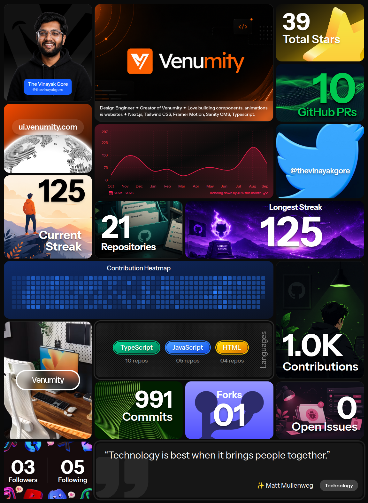
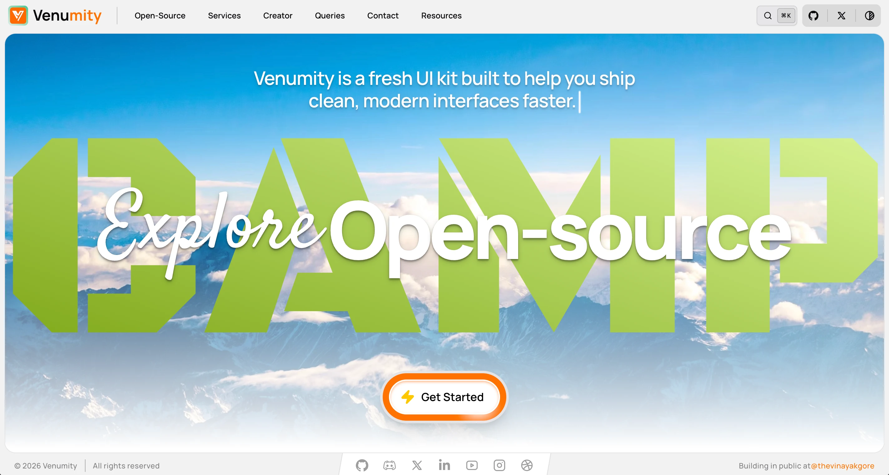
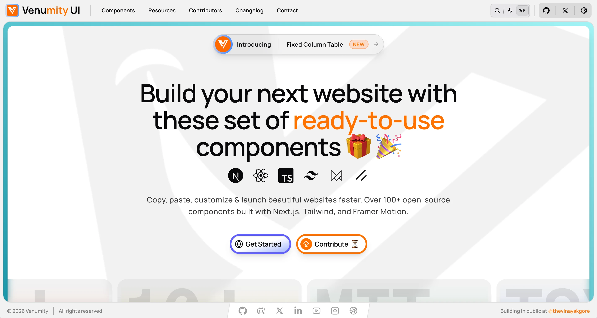
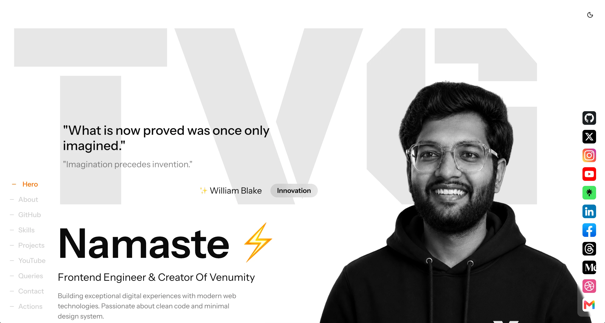
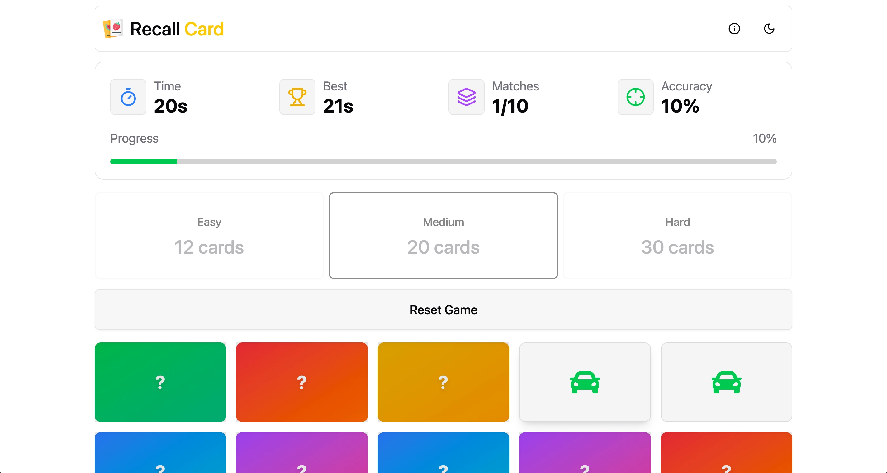

<!-- Bento Card - Updated Daily -->

  

<!-- Star this profile CTA -->

  

---

  
  
  
  
  
  
  
  
  
  
  
  
  
  
  
  
  

---

<table>
  <tr>
    <td width="50%">
      

        
      

    </td>
    <td width="50%">
      

        
      

    </td>
  </tr>
  <tr>
    <td width="50%">
      

        
      

    </td>
    <td width="50%">
      

        
      

    </td>
  </tr>
</table>

  
  
  
  
  
  
  

---

<!-- Star CTA -->

  

<!-- Footer Wave -->

  

